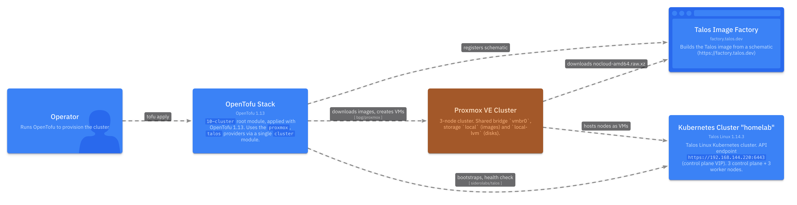
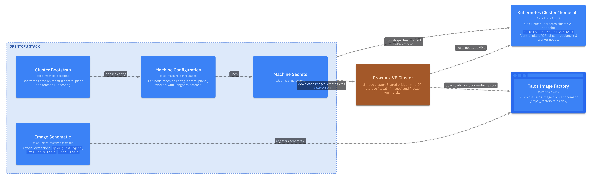
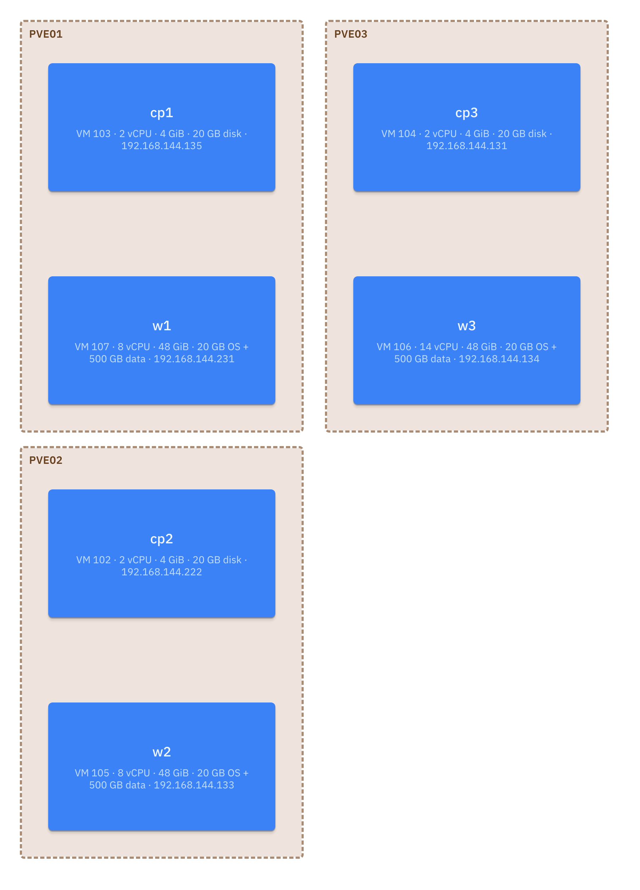
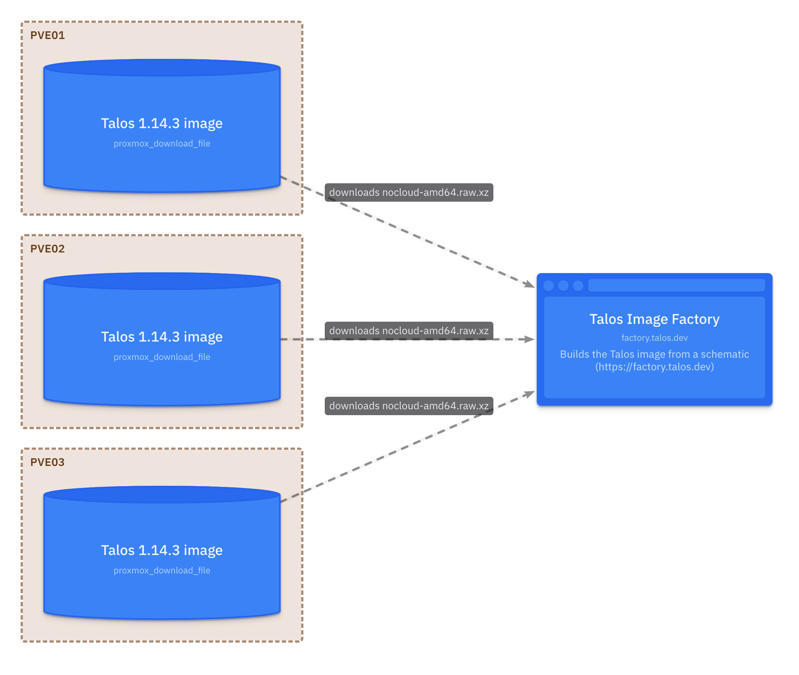
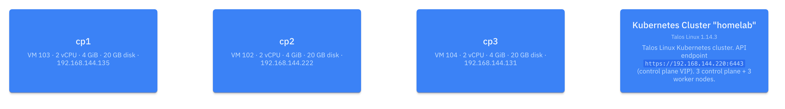
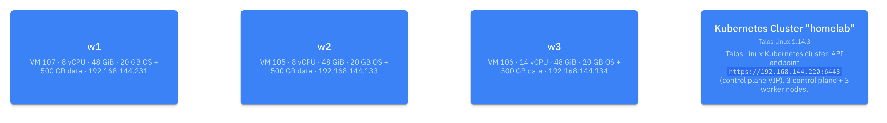

# 10-cluster

Root OpenTofu module that provisions a Talos Linux Kubernetes cluster on a three-node Proxmox VE cluster. It composes configuration from `environments/` and delegates the heavy lifting to the [`terraform-proxmox-talos-k8s`](https://github.com/jkososki/terraform-proxmox-talos-k8s) module (`v0.0.5`).

## Architecture

### Landscape



### Provisioning pipeline



### Proxmox hosts and VMs



### Talos image distribution



### Control plane and worker nodes

 

## Cluster layout

| Node | Role | Proxmox host | VM ID | vCPU | RAM | Disks |
| --- | --- | --- | --- | --- | --- | --- |
| cp1 | control plane | pve01 | 103 | 2 | 4 GiB | 20 GB |
| cp2 | control plane | pve02 | 102 | 2 | 4 GiB | 20 GB |
| cp3 | control plane | pve03 | 104 | 2 | 4 GiB | 20 GB |
| w1 | worker | pve01 | 107 | 8 | 48 GiB | 20 GB + 500 GB |
| w2 | worker | pve02 | 105 | 8 | 48 GiB | 20 GB + 500 GB |
| w3 | worker | pve03 | 106 | 14 | 48 GiB | 20 GB + 500 GB |

- Talos Linux 1.14.3, image built by the Talos Image Factory with the `qemu-guest-agent`, `util-linux-tools` and `iscsi-tools` extensions.
- All VMs sit on bridge `vmbr0`; disks are on `local-lvm`, images on `local`.
- The Kubernetes API is served from the control plane VIP `https://192.168.144.220:6443`.

## Configuration

Inputs come from two YAML files, merged with `provider::deepmerge::mergo` (override wins):

| Variable | Description |
| --- | --- |
| `base_config_path` | Base configuration (`environments/base.yaml`) |
| `override_config_path` | Environment overrides (`environments/<env>/config.yaml`) |

The merged config is validated by [`modules/inputs`](../modules/inputs) and passed to the cluster module (`kubernetes_version`, `talos_version`, `iso_datastore`, `cluster_name`, `gateway_ip`, `cluster_vip`, `pve_hosts`, `controlplane_nodes`, `worker_nodes`, `talos_system_extensions`).

## Usage

Run from the repository root with [Task](https://taskfile.dev) (environment defaults to `proxmox`):

```sh
task init-10
task plan-10
task apply-10
task export-configs   # overwrites ~/.kube/config and ~/.talos/config
```

State is stored locally at `environments/proxmox/state/10-cluster.tfstate` and is git-ignored.

## Requirements

| Name | Version |
| --- | --- |
| OpenTofu | >= 1.13.1 |
| `bpg/proxmox` | ~> 0.116.1 |
| `siderolabs/talos` | ~> 0.12.0 |
| `hashicorp/http` | ~> 3.6.3 |
| `isometry/deepmerge` | ~> 1.0 |

## Outputs

| Name | Description | Sensitive |
| --- | --- | --- |
| `talosconfig` | Talos client configuration for `talosctl` | yes |
| `kubeconfig` | Kubeconfig for the new cluster | yes |
| `controlplane_nodes` | Control plane VM IDs and interfaces | no |
| `worker_nodes` | Worker VM IDs and interfaces | no |

## Updating the diagrams

GitHub can't render LikeC4, so export PNGs and commit them. After editing the `.c4` files:

```sh
npx likec4 validate --no-layout docs/architecture
npx likec4 export png docs/architecture --outdir docs/images --flatten
```

To explore interactively: `npx likec4 serve docs/architecture`.
